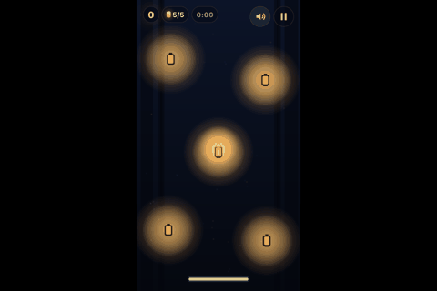
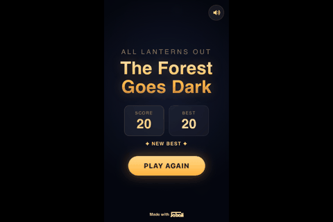
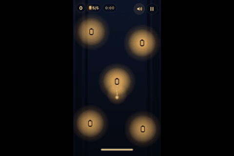
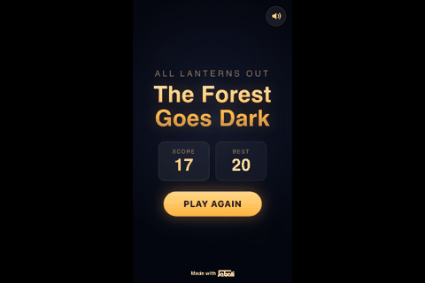
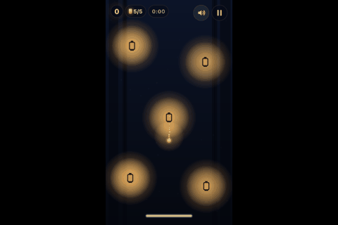
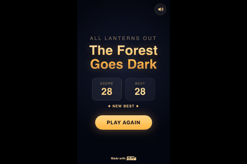

# Playtest report: Lantern Keeper

## Session

- Targets: url: https://www.jabali.ai/play/cb62908a-ac7e-4404-9518-6f1550b522d6/quick-game/mothlight-last-lantern-standing/
- Model: openai gpt-5-mini / gpt-5 (117 calls, 184,450 input / 76,419 output tokens)
- Runs per player: 3, max 60.0s of game time each. Wall time 5461s.
- Generated 2026-11-02 00:55, re-scored 2026-11-02 00:57 with openai (1 judge calls)

## Verdict

**MIXED**, fun score 6/10. Tense lantern‑juggling feels good and responsive, but unclear lockout/dash cues and shallow early skill expression cap the fun.

Measured scorecard average: 3.6/5 across 10 dimensions.

## Fun scorecard

| Dimension | Measured | Judge | Signal | Why | Scale |
|---|---|---|---|---|---|
| clarity | 3 | 3 | seconds_to_first_point: 1, start_retries: 0, runs_that_never_started: 0, confusion_notes: 6 | First point came at 1.0s, but there were 6 confusion notes (e.g., "It wasn’t obvious at a glance that the dark lantern I was on was locked"), so the measured score of 3 fits. | first point within 5s = 5, 10s = 4, 20s = 3, 40s = 2, none = 1; minus retries/confusion |
| feedback | 5 | 5 | inputs_checked: 132, reacted_share: 1 | Inputs reacted 100% of the time (reacted_share 1.0; 0/132 unresponsive), matching the 5. | reacted share >= .9 = 5, .75 = 4, .5 = 3, .3 = 2 |
| challenge | 4 | 4 | median_survival_s: 17.4, instant_death_share: 0, timeout_share: 0, runs_cut_by_call_budget: 2 | Median survival was 17.4s with 0% instant deaths; deaths clustered at 15–20s (4 deaths) and 20–25s (2), supporting a brisk but fair 4. | median survival >= 20s = 5, 10s = 4, 5s = 3, 2s = 2; -1 if >30% die in 3s; 2 if almost all runs time out |
| skill_depth | 1 | 1 | skilled_avg_score: 17.5, random_avg_score: 21.67, score_ratio: 0.82, survival_ratio: 0.94 | Skilled avg score 17.5 vs random 21.67 (ratio 0.82) shows button‑mashers did as well or better, so the low 1 is warranted. | (skilled+1)/(random+1) score ratio >= 3 = 5, 2 = 4, 1.3 = 3, 1.05 = 2 |
| learnability | 3 | 3 | player: rules, early_avg: 17, late_avg: 20, trend_per_run: 2.5 | Rules player improved (trend +2.5 per run; early_avg 17 to late_avg 20; best survival 22.33 from 16.77), aligning with 3. | relative gain late vs early runs >= 1 = 5, .4 = 4, .1 = 3, flat = 2 |
| reward_cadence | 5 | 5 | score_events: 142, median_gap_s: 1, longest_gap_s: 2.2 | 142 score events with 1.0s median gap and 2.2s longest gap gives very frequent rewards (5). | median gap between rewards <= 3s = 5, 6s = 4, 12s = 3, 25s = 2; none = 1 |
| variety | 2 | 2 | distinct_screens: 3, per_minute: 1.23, new_screens_in_second_half_of_longest_run: 0 | Only 3 distinct screens at 1.23 per minute and 0 new screens in the second half of the longest run, matching 2. | distinct screens per minute >= 6 = 5, 3 = 4, 1.5 = 3, .5 = 2 |
| fairness | 5 | 5 | deaths_judged: 4, avoidable_share: 1, instant_deaths: 0 | Avoidable_share 1.0, instant_deaths 0; players called deaths fair (e.g., "I dashed too late"), so 5 fits. | share of deaths the player says were avoidable |
| replay_pull | 4 | 4 | answers: 4, 4, 4, 4, 4, 4, average: 4 | Average 'play again?' = 4 across 6 answers (all were 4). | average answer to 'play again?' |
| delivers_design | 4 | 4 | seen: Lanterns burn down, Relight by touching, Dash with meter, Relight lockout, Game over when none lit, never_seen: Waves escalate, Timed drops/events | 5/7 mechanics seen (e.g., 'Relight lockout'); 'Waves escalate' and 'Timed drops/events' were never seen, giving 4. | share of coded mechanics reached in play |

## Gameplay metrics

| Metric | All | random | rules | vision |
|---|---|---|---|---|
| runs | 9 | 3 | 3 | 3 |
| avg_survival_s | 16.29 | 18.52 | 19.04 | 11.3 |
| median_survival_s | 17.28 | 17.82 | 18.02 | 12.87 |
| best_survival_s | 22.33 | 20.47 | 22.33 | 13.6 |
| avg_score | 17.33 | 21.67 | 19 | 11.33 |
| best_score | 28 | 28 | 22 | 14 |
| win_rate | 0 | 0 | 0 | 0 |
| actions_per_minute | 373.3 | 155.5 | 700.6 | 178.8 |
| avg_time_to_start_s | 0.53 | 0.53 | 0.53 | 0.53 |
| llm_calls | 116 | 0 | 4 | 108 |
| ends | death: 7, budget: 2 | death: 3 | death: 3 | death: 1, budget: 2 |

## Failure analysis

| Cause of death (grouped) | Count |
|---|---|
| Zero‑lit while other lanterns were locked | 3 |
| Last‑lit faded while en route (late dash) | 1 |
| All lanterns out (unspecified) | 3 |

| Run | Player | Ended | At (s) | Score | Player's account | Avoidable? |
|---|---|---|---|---|---|---|
| 1 | rules | death | 16.77 | 17 | The last lit lantern faded out while I was sitting on a dark lantern that was still locked and couldn’t be relit yet. | True |
| 2 | rules | death | 18.02 | 18 | The last remaining lit lantern (at ~x360,y668) dimmed to zero while I was sitting on it; all other lanterns were already dark and locked, so when that one went out, all lanterns were out at the same time. | True |
| 3 | rules | death | 22.33 | 22 | The last remaining lit lantern dimmed to zero while I was still moving toward it; I dashed too late to keep it alive. | True |
| 1 | vision | death | 12.87 | 13 | The center lantern was instantly extinguished and locked while I was on it, leaving only the top-left lantern lit; a moment later that last lantern burned out, so all lanterns were dark at once. | True |

- Repeated failure points (same score at death): score 17 x2
- Repeated death positions: wave 0-1 x7, player_x 350-400 x3, player_y 600-650 x2
- Deaths by time into run: 15-20s x4, 20-25s x2, 10-15s x1
- Instant deaths (under 3s): 0
- Stalls: 0; agent loops: 0; runs that never started: 0
- Inputs with no visible reaction: 0 of 132 checked
- UI confusion: How to tell which dark lanterns are currently locked and when they’ll unlock.
- UI confusion: Whether simply touching a lantern slows its burn or refuels it, and how drop timing/collection actually works. A clear lock/unlock timer on each lantern would help.
- UI confusion: How the dash meter charges and the exact threshold to spend it weren’t obvious, and the rate at which touching restores lantern brightness isn’t clearly conveyed.
- UI confusion: Does standing on a lantern protect it from being extinguished? How long is the relight lockout and where is it shown? What does the 'next drop in' timer spawn and where does it land?
- UI confusion: Not clear if hugging a lantern recharges it or just slows decay, what exactly triggers a budget lock, or how long a lock lasts—some countdown/telegraph would help.
- UI confusion: It’s not clear when/if a dark lantern can be relit—there’s no visible cooldown or timer. Also unsure whether I should use drag or keyboard by default, and what dash actually does.

## Behavioural observations

- Runs were short but not instant: median survival 17.4s with 0% instant deaths; 4 of 7 deaths occurred at 15–20s.
- Responsiveness is excellent: 132 inputs checked with 1.0 reacted_share and 0 unresponsive examples.
- Skill expression is weak early: skilled_avg_score 17.5 vs random 21.67 (ratio 0.82) and survival_ratio 0.94.
- Frequent scoring feedback: 142 score events, 1.0s median gap; longest gap only 2.2s.
- Key systems were opaque: 6 confusion notes, e.g., "It wasn’t obvious… which dark lanterns are locked and for how long" and "dash meter charges and the exact threshold… weren’t obvious".
- Two intended systems didn’t surface in play: 'Waves escalate' and 'Timed drops/events' were never seen despite best survival 22.33s and drops set at ~6.2s.
- UI hazard: "The top-right UI (mute/pause) is easy to tap by accident" interrupted a run.
- Control usage skewed to keyboard; 'fly (drag)' was never used, and the vision player asked "unsure whether I should use drag or keyboard by default."

- random: scores by run [20, 17, 28], trend 4/run, inputs tap:Space: 36, hold:ArrowUp: 19, hold:ArrowRight: 17, hold:ArrowDown: 14, hold:KeyD: 12, hold:KeyS: 11, hold:KeyW: 9, hold:ArrowLeft: 9
- rules: scores by run [17, 18, 22], trend 2.5/run, inputs hold:ArrowDown: 627, hold:ArrowLeft: 32, hold:ArrowUp: 5, tap:Space: 3
- rules strategy v1: Continuously route to the most urgent lantern: nearest unlocked-out first, otherwise the dimmest lit. Stick briefly while touching to top it off. Dash only for long/urgent legs (out saves or when lit count is low) after a short aim delay.
- rules strategy v2: Keep prioritizing the nearest unlocked, unlit lantern. Add an emergency rule: if only one lantern is lit (or it’s getting dim), go top it off instead of chasing others. Never idle on a locked dark lantern. Use recognized keycodes (KeyWASD/Arrow keys) and dash with Space. Maintain brief stickiness when touching to finish topping off. Dash aggressively when only one lit remains or when heading to an unlocked dark lantern that’s far.
- rules strategy v3: Keep what worked (nearest unlocked dark targeting, brief stickiness, dash when urgent), but avoid camping a lone, dying lantern into an inevitable wipe. New rules: (1) If only one lantern is lit, only babysit it if it’s critically low; otherwise prioritize any unlocked dark, or pre-position at the soonest-to-unlock dark; if neither exists and a drop is imminent, hover center to intercept. (2) If any lit lantern is dangerously low, tend it briefly (reduced stickiness) so we don’t cascade to zero lit. (3) Use next_drop_in_ms to time dashes for urgent targets. (4) Slightly faster dash cadence and lower thresholds when only one lantern is lit or the target is dark. (5) Never idle on a locked dark; already covered, keep it.
- rules strategy v4: Keep the winning structure (nearest unlocked dark, brief stickiness, drop-aware pre-positioning), but add a hard-commit babysit mode for one-lit endgame and a true panic dash. Specifically: (1) When only one lantern is lit and no unlock is imminent, glue to it until it’s safely bright or the next drop is near; extend stickiness while touching. (2) Lower dash thresholds and fire earlier when one-lit, especially if brightness dips under 0.14 or distance is large. (3) Maintain existing fail-safes (never idle on locked dark, pre-position for soonest unlock, center intercept only if a drop is imminent and the lone light is safe).
- rules learned: Dark lanterns can be in a locked state after going out; touching them before the lock expires does nothing.
- rules learned: Hugging a lit lantern doesn’t refill it by itself; if others are dark-and-locked you can get forced into an unwinnable endgame. You need to keep more than one lantern alive or be ready to intercept refuels/unlocks.
- rules learned: With only one lantern lit, you must stay on it to keep it burning; locked dark lanterns can’t be revived until they unlock, and dash uses a charge meter that unlocks around 20s.
- vision: scores by run [13, 14, 7], trend -3/run, inputs click(0.50,0.52): 52, click(0.79,0.08): 36, click(0.57,0.28): 6, click(0.58,0.45): 3, click(0.79,0.28): 2, click(0.50,0.75): 1, click(0.50,0.90): 1
- vision learned: Lanterns can be snuffed and enter a relight lockout even when nearly full, so you need at least two buffered to avoid a zero-lit moment.
- vision learned: If you let most lanterns go dark/locked, a single budget event can instantly end the run—keep at least two lit as redundancy.
- vision learned: Extinguished lanterns seem to have a cooldown/lockout before they can be relit.
- Controls the thinking players never used: fly (drag), move right, move left (WASD), move right (WASD), move up (WASD), move down (WASD)
- Coded mechanics never reached in play: Waves escalate, Timed drops/events
- Coded mechanics reached: Lanterns burn down, Relight by touching, Dash with meter, Relight lockout, Game over when none lit

## Suggested improvements

- **ux**: Show a visible lockout countdown on dark lanterns using each lantern’s lockedUntil vs elapsedMs (e.g., a shrinking ring/padlock icon and a distinct locked tint). *Why:* Players couldn’t tell which dark lanterns were locked or for how long (6 confusion notes; e.g., "no visible cooldown or timer"). The lantern hook exposes lockedUntil, so surfacing it removes guesswork.
- **feedback**: When touching a lantern, visibly pulse its brightness and show a small on‑lantern fill meter tied to brightness (b) so refueling vs mere slowing is unmistakable. *Why:* Players asked whether "simply touching… slows its burn or refuels it" and noted "Hugging a lit lantern doesn’t refill it by itself"; clearer per‑tick refuel feedback clarifies the mechanic.
- **ux**: Make the dash meter (0–100) state explicit: segment the bottom bar and flash/‘READY’ when dash is available; add a first‑run prompt: “Space to Dash; consumes the blue bar.” *Why:* Confusion: "how the dash meter charges and the exact threshold to spend it weren’t obvious". Difficulty text confirms meter 0–100; making readiness explicit helps timing (a cited death was "I dashed too late").
- **content**: Telegraph timed drops/events: display a 'next_drop_in' countdown using next_drop_in_ms and an on‑arena spawn ping/arrow a moment before it lands. *Why:* Timed drops are set to ~6.2s but were never seen; players asked "what does the 'next drop in' timer spawn and where does it land?" Making the timer/location visible ensures the mechanic actually impacts sub‑20s runs.
- **content**: Surface the first wave escalation earlier than it is now so it occurs within the typical 15–20s window of early runs. *Why:* Longest run was 22.33s, yet 'Waves escalate' was never seen; moving the first escalation into that window will showcase progression.
- **balance**: Slightly reduce relight lockout duration or allow touching a just‑snuffed lantern to shave some remaining lockout time, so one‑light endgames are recoverable. *Why:* Multiple frustrations: "Being stuck with four locked lanterns and one fading light for several seconds felt punishing" and "A lantern getting snuffed and hard‑locked while I was standing on it felt punishing."
- **ux**: Move pause/mute away from the top‑right edge (or require hold‑to‑pause, or shrink its hitbox) to prevent accidental taps during play. *Why:* A player reported "The top-right UI (mute/pause) is easy to tap by accident, which interrupts play."
- **tutorial**: Add a one‑screen first‑run overlay: “WASD/Arrows or drag to move. Space to dash. Touch lanterns to refuel. Dark lanterns may be locked—watch the countdown ring.” *Why:* Controls/tactics weren’t clear: 'fly (drag)' was never used, and players were "unsure whether I should use drag or keyboard by default" and how relight/lockout works.

## What the agent understood about the game

Profile built from **the running page only**. Lantern Keeper (Arcade survival (arena)). Goal: Keep at least one lantern burning for as long as possible. Lose: All lanterns go out at the same time. Win: endless. Controls: fly (drag) (None, hold), move left (ArrowLeft, hold), move right (ArrowRight, hold), move up (ArrowUp, hold), move down (ArrowDown, hold), move left (WASD) (KeyA, hold), move right (WASD) (KeyD, hold), move up (WASD) (KeyW, hold), move down (WASD) (KeyS, hold), dash (Space), dash (double-tap) (None).

- How you lose: All lanterns go out at the same time.
- Difficulty notes: Juggling five lanterns placed around the arena while their brightness drains; you must route efficiently to prevent a full blackout. Dash meter (0–100) limits how often you can burst across the map. Pressure escalates with waves. Timed drops/events roughly every ~6.2s (nextDropAtMs ≈ 6200). Brief relight lockouts punish late saves.
- Tips: Fly a consistent loop that visits all lanterns before any get critical, adjusting to prioritize the dimmest one next. Stay near the center between relights so you can reach edges quickly. Save dash for emergencies—cross-map saves or when two lanterns are about to fail—rather than small corrections. Glance at the lit count and timer to plan your next pivot. If a lantern locks after snuffing, immediately switch targets instead of waiting. Collect any drops on the way between lanterns rather than detouring.

| State hook | Expression | During play |
|---|---|---|
| score | `(() => { const s = game?.scene?.getScene?.('GameScene'); return s ? Math.floor(s.scoreFloat ?? 0) : 0; })()` | live (29+ distinct values) |
| playing | `(() => { const s = game?.scene?.getScene?.('GameScene'); return !!(s && s.running && !s.over); })()` | live (2+ distinct values) |
| over | `(() => { const s = game?.scene?.getScene?.('GameScene'); return !!(s && s.over); })()` | live (2+ distinct values) |
| player_x | `(() => { const s = game?.scene?.getScene?.('GameScene'); return s?.player?.x ?? null; })()` | live (50+ distinct values) |
| player_y | `(() => { const s = game?.scene?.getScene?.('GameScene'); return s?.player?.y ?? null; })()` | live (50+ distinct values) |
| lanterns_total | `(() => { const s = game?.scene?.getScene?.('GameScene'); const ls = s?.lanterns \|\| []; return ls.length \|\| 0; })()` | constant (5) |
| lanterns_lit | `(() => { const s = game?.scene?.getScene?.('GameScene'); const ls = s?.lanterns \|\| []; return ls.reduce((a,l)=>a + (((l?.brightness ?? 0) > 0) ? 1 : 0), 0); })()` | live (6+ distinct values) |
| lanterns_out | `(() => { const s = game?.scene?.getScene?.('GameScene'); const ls = s?.lanterns \|\| []; const lit = ls.reduce((a,l)=>a + (((l?.brightness ?? 0) > 0) ? 1 : 0), 0); return (ls.length \|\| 0) - lit; })()` | live (6+ distinct values) |
| time_s | `(() => { const s = game?.scene?.getScene?.('GameScene'); return Math.floor((s?.elapsedMs ?? 0) / 1000); })()` | live (21+ distinct values) |
| wave | `(() => { const s = game?.scene?.getScene?.('GameScene'); return s?.wave ?? 0; })()` | constant (0) |
| dash | `(() => { const s = game?.scene?.getScene?.('GameScene'); return Math.floor(s?.dashMeter ?? 0); })()` | live (50+ distinct values) |
| dashing | `(() => { const s = game?.scene?.getScene?.('GameScene'); return !!s?.dashing; })()` | live (2+ distinct values) |
| next_drop_in_ms | `(() => { const s = game?.scene?.getScene?.('GameScene'); const eta = (s?.nextDropAtMs ?? 0) - (s?.elapsedMs ?? 0); return Math.max(0, eta); })()` | live (50+ distinct values) |
| lanterns | `(() => { const s = game?.scene?.getScene?.('GameScene'); const ls = s?.lanterns \|\| []; const now = s?.elapsedMs \|\| 0; return ls.map((l, i) => ({ i: (l?.index ?? i), x: l?.x ?? 0, y: l?.y ?? 0, b: l?.brightness ?? 0, touching: !!l?.touching, lockedUntil: l?.lockedUntil ?? 0 })); })()` | live (50+ distinct values) |
| elapsed_ms | `(() => { const s = game?.scene?.getScene?.('GameScene'); return s?.elapsedMs ?? 0; })()` | live (50+ distinct values) |
| w | `(() => (game?.scale?.width ?? (game?.config?.width ?? 720)))()` | constant (720) |
| h | `(() => (game?.scale?.height ?? (game?.config?.height ?? 1280)))()` | constant (1280) |

| Designed mechanic | Detail |
|---|---|
| Lanterns burn down | Five lanterns slowly lose life/brightness over time; if all go out simultaneously, the run ends. |
| Relight by touching | Touch a lantern with your firefly to sustain or relight it. |
| Dash with meter | Dash gives a fast burst in your facing/aim direction and consumes dash meter; it ends after a short duration. |
| Relight lockout | Recently snuffed lanterns are briefly locked and cannot be immediately reignited. |
| Waves escalate | Difficulty increases over waves, raising the pressure to keep lanterns lit. |
| Timed drops/events | Periodic drops or events occur on a timer. |
| Game over when none lit | If every lantern is out at once, the run ends immediately. |

## Runs

| # | Player | Ended | Seconds | Score | Inputs | Play again? | Why |
|---|---|---|---|---|---|---|---|
| 1 | random | death | 20.47 | 20 | 60 | - |  |
| 2 | random | death | 17.28 | 17 | 42 | - |  |
| 3 | random | death | 17.82 | 28 | 42 | - |  |
| 1 | rules | death | 16.77 | 17 | 0 | 4 | I want to try again with better routing and an emergency rule to protect the last lit lantern. |
| 2 | rules | death | 18.02 | 18 | 282 | 4 | I want to try a route that keeps two lanterns stable and pre-positions for unlocks/drops. |
| 3 | rules | death | 22.33 | 22 | 385 | 4 | I can do better by camping the last lantern and using dash earlier; the core loop is tense and satisfying. |
| 1 | vision | death | 12.87 | 13 | 23 | 4 | Now that I understand the lockout, I want to try keeping two lanterns buffered and watch the drop timer. |
| 2 | vision | budget | 13.6 | 14 | 25 | 4 | I want to try rotating and dashing between lanterns to keep multiple alive and see if I can avoid sudden budget locks. |
| 3 | vision | budget | 7.43 | 7 | 53 | 4 | I want a proper run to try movement and relighting now that I know about the cooldown. |

