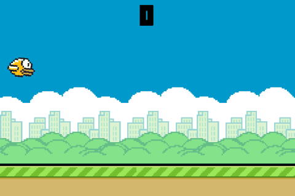
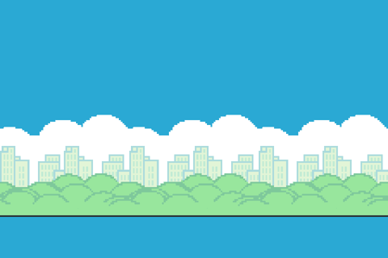
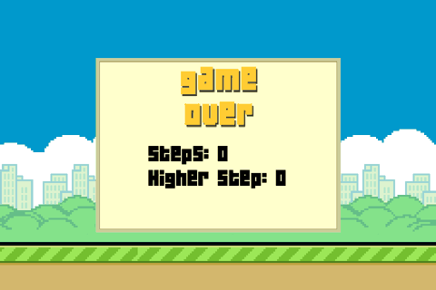

# Playtest report: Clumsy Bird

## Session

- Targets: code: games/clumsy-bird; url: https://ellisonleao.github.io/clumsy-bird/
- Model: openai gpt-5-mini / gpt-5 (211 calls, 171,659 input / 96,077 output tokens)
- Runs per player: 5, max 60.0s of game time each. Wall time 1356s.
- Generated 2026-11-01 23:21, re-scored 2026-11-02 00:38 with openai (2 judge calls)

## With code vs URL only

|  | code | url |
|---|---|---|
| profile_from | code | blind |
| state_hooks | 13 | 2 |
| live_hooks | 12 | 1 |
| players | random, rules | random, vision |
| best_thinking_avg_score | 0.8 | 0 |
| best_thinking_avg_survival_s | 2.89 | 1.99 |
| best_score | 2 | 0 |
| llm_calls | 6 | 200 |
| measured_fun | 3.9 | 3.2 |

With code access: 13 state hooks and 12 live hooks vs 2 and 1 on URL; included a 'rules' player; best_thinking_avg_score 0.8 and best_score 2 vs 0; measured_fun 3.9 vs 3.2; llm_calls 6 vs 200. Code access improved instrumentation and allowed limited scoring that didn’t occur on URL.

## Verdict (with code)

**MIXED**, fun score 5/10. Snappy Flappy clone with great reward cadence but brutal first 3s and unclear start/lip collisions

Measured scorecard average: 3.9/5 across 10 dimensions.

## Fun scorecard (with code)

| Dimension | Measured | Judge | Signal | Why | Scale |
|---|---|---|---|---|---|
| clarity | 1 | 1 | seconds_to_first_point: none in first run, start_retries: 0, runs_that_never_started: 0, confusion_notes: 4 | No point scored in the first run ('none in first run') and 4 confusion notes; avg_time_to_start_s is 2.61 while 'inputs before that don't move the bird' due to Get Ready. | first point within 5s = 5, 10s = 4, 20s = 3, 40s = 2, none = 1; minus retries/confusion |
| feedback | 5 | 5 | inputs_checked: 11, reacted_share: 1 | Inputs checked 11 with 1.0 reacted_share; player noted 'quick recoveries... felt snappy.' | reacted share >= .9 = 5, .75 = 4, .5 = 3, .3 = 2 |
| challenge | 1 | 1 | median_survival_s: 2.7, instant_death_share: 0.6, timeout_share: 0, runs_cut_by_call_budget: 0 | Median survival 2.7s with 60% instant deaths ('instant_death_share': 0.6) and 10/10 deaths in 0-5s. | median survival >= 20s = 5, 10s = 4, 5s = 3, 2s = 2; -1 if >30% die in 3s; 2 if almost all runs time out |
| skill_depth | 3 | 3 | skilled_avg_score: 0.8, random_avg_score: 0, score_ratio: 1.8, survival_ratio: 1.49 | Rules bot avg_score 0.8 vs random 0 (score_ratio 1.8) and survival 2.89s vs 1.94s (survival_ratio 1.49). | (skilled+1)/(random+1) score ratio >= 3 = 5, 2 = 4, 1.3 = 3, 1.05 = 2 |
| learnability | 5 | 5 | player: rules, early_avg: 0, late_avg: 1.33, trend_per_run: 0.6 | Rules bot improved from early_avg 0 to late_avg 1.33 with trend_per_run 0.6. | relative gain late vs early runs >= 1 = 5, .4 = 4, .1 = 3, flat = 2 |
| reward_cadence | 5 | 5 | score_events: 4, median_gap_s: 1.69, longest_gap_s: 2.8 | 4 score events with median_gap_s 1.69 (<=3s threshold). | median gap between rewards <= 3s = 5, 6s = 4, 12s = 3, 25s = 2; none = 1 |
| variety | 5 | 5 | distinct_screens: 36, per_minute: 89.4, new_screens_in_second_half_of_longest_run: 4 | 36 distinct screens at 89.4 per minute; 4 new screens in second half of the longest run. | distinct screens per minute >= 6 = 5, 3 = 4, 1.5 = 3, .5 = 2 |
| fairness | 5 | 5 | deaths_judged: 5, avoidable_share: 1, instant_deaths: 8 | All 5 judged deaths were avoidable (avoidable_share 1.0). | share of deaths the player says were avoidable |
| replay_pull | 4 | 4 | answers: 4, 4, 4, 4, 4, average: 4 | Play-again answers were [4,4,4,4,4] with average 4. | average answer to 'play again?' |
| delivers_design | 5 | 5 | seen: Get Ready delay, Scrolling pipes, Scoring, Death and fall, Mute, never_seen:  | All coded mechanics were seen ['Get Ready delay','Scrolling pipes','Scoring','Death and fall','Mute']; none were missed. | share of coded mechanics reached in play |

## Gameplay metrics (with code)

| Metric | All | random | rules |
|---|---|---|---|
| runs | 10 | 5 | 5 |
| avg_survival_s | 2.42 | 1.94 | 2.89 |
| median_survival_s | 2.44 | 1.83 | 2.7 |
| best_survival_s | 4.53 | 2.78 | 4.53 |
| avg_score | 0.4 | 0 | 0.8 |
| best_score | 2 | 0 | 2 |
| win_rate | 0 | 0 | 0 |
| actions_per_minute | 243.4 | 327.8 | 186.7 |
| avg_time_to_start_s | 2.61 | 2.61 | 2.61 |
| llm_calls | 6 | 0 | 6 |
| ends | death: 10 | death: 5 | death: 5 |

## Failure analysis (with code)

| Cause of death (grouped) | Count |
|---|---|
| Unknown early collision before first point (random bot) | 5 |
| Ground collision before first pipe | 1 |
| Clipped top lip entering first gap | 2 |
| Clipped bottom pipe right after scoring 2 (trailing lip on exit) | 2 |

| Run | Player | Ended | At (s) | Score | Player's account | Avoidable? |
|---|---|---|---|---|---|---|
| 1 | rules | death | 0.6 | 0 | Hit the ground before reaching the first pipe (no flap registered during the initial descent). | True |
| 2 | rules | death | 2.48 | 0 | Clipped the upper pipe lip while entering the first gap after a late panic flap near the pipe. | True |
| 3 | rules | death | 2.7 | 0 | Clipped the top lip of the very first pipe while entering the gap right after a late flap. | True |
| 4 | rules | death | 4.53 | 2 | Clipped the bottom pipe of the next gap after scoring 2 — the next gap was much higher and I started climbing too late. | True |
| 5 | rules | death | 4.15 | 2 | Clipped the bottom lip of the pipe right after scoring the second point while descending out of the gap. | True |

- Repeated failure points (same score at death): score 0 x8, score 2 x2
- Deaths by time into run: 0-5s x10
- Instant deaths (under 3s): 8
- Stalls: 0; agent loops: 0; runs that never started: 0
- Inputs with no visible reaction: 0 of 11 checked
- UI confusion: Whether the game is fully accepting inputs at the very start isn’t obvious; the bird is already falling while Get Ready appears.
- UI confusion: The exact “too high” threshold at the top isn’t obvious; I briefly went partly off-screen early without dying.
- UI confusion: How far above the screen counts as a death isn’t obvious—I briefly went above y=0 earlier without losing.
- UI confusion: Scoring triggers before you’re actually past the pipes; it wasn’t obvious at first that you can still die on the trailing lip right after the point.

## Behavioural observations (with code)

- Runs are extremely short: overall median_survival_s 2.44 and 10/10 deaths occurred in the 0-5s window, with 8 instant_deaths.
- Scoring is rare: avg_score 0.4 with repeated 0‑score deaths = 8, and best_score only 2.
- The skilled bot outperforms random: rules avg_score 0.8 vs random 0 (score_ratio 1.8) and survival 2.89s vs 1.94s (survival_ratio 1.49).
- Start is unclear: avg_time_to_start_s 2.61 and 'Early input seems to be ignored during a short Get Ready window' plus 'Whether the game is fully accepting inputs at the very start isn’t obvious.'
- Lip collisions are a common failure: 'Clipped the upper pipe lip...' (runs 2 and 3) and 'Clipped the bottom pipe... right after scoring the second point' (runs 4 and 5).
- Score timing misleads: 'Scoring triggers before you’re actually past the pipes; ... you can still die on the trailing lip right after the point.'
- Physics are crisp and readable: inputs reacted 1.0/1.0 and 'The quick recoveries where a single tap pulled me back toward the gap felt snappy.'
- Difficulty pacing is harsh early: 60% instant deaths and 8 deaths at score 0; pipes move -5 px/update with 92‑update spawns and effective gap ≈212 px.

- random: scores by run [0, 0, 0, 0, 0], trend 0/run, inputs tap:Space: 30, tap:KeyM: 23
- rules: scores by run [0, 0, 0, 2, 2], trend 0.6/run, inputs tap:Space: 41, tap:KeyM: 4
- rules strategy v1: Tap early to stay near the center of the next gap, tightening tolerance as it approaches. Emergency-flap near the ground and avoid flapping when near the top.
- rules strategy v2: Keep gap-centering logic, but add a startup safety phase that taps more frequently for the first dozen frames to survive any Get Ready/input-lock, strengthen near-ground emergencies, and slightly reduce early cooldown. Maintain ceiling-avoidance and dynamic target banding near pipes.
- rules strategy v3: Keep the solid gap-centering and early-game safety, but prevent last-second flaps from launching into the top pipe. Bias target slightly below gap center when close to pipes. Scale the near-ground bail-out so it only triggers when we’re genuinely low (and below center), and add a no-flap zone within ~26px of the gap’s top when close, except in true ground emergencies. Maintain ceiling avoidance and cooldown debouncing.
- rules strategy v4: Keep the stable gap-centering and early safety but add stronger mouth-of-gap lip guards and a short no-flap window when arrival is imminent. Bias target further below center when close, lengthen cooldown near pipes, and use an estimated time-to-pipe from gap motion to suppress last-instant lifts that cause top-lip collisions. Retain ceiling avoidance and ground bailouts.
- rules strategy v5: Keep the stable centering and lip guards, but add an early climb strategy when the next gap is far above: detect score-passage and big upward shift, start a short climb-boost with a lower cooldown and a tighter target band while still far from the pipes. Widen the early 'too low for next gap' bailout distance, and make cooldown dynamic (shorter when far/low, longer near the mouth). Preserve ceiling/ground safety and lip-guard suppression unless we’re clearly low.
- rules strategy v6: Keep the stable gap-centering and mouth-of-gap lip guards, but add an explicit exit-guard right after a score: for a short window after passing a pipe, treat the just-passed gap’s bottom lip as dangerous and bail out sooner to prevent trailing-lip collisions. Track the last gap geometry on the frame before scoring to know that bottom lip, and flap if we descend too close while exiting. Do not change the next-gap targeting or ceiling/ground safeties, and keep the cooldown and time-to-pipe suppression for last-instant flaps.
- rules learned: You need an immediate early flap to stabilize, and there may be a brief Get Ready phase that can ignore the first input.
- rules learned: Near a pipe, a single late flap can pop you into the top edge; it’s safer to line up a bit below center with earlier, smaller taps.
- rules learned: Last‑second flaps near the pipe mouth will pop you upward into the top lip; staying slightly below center when close is safer.
- rules learned: Gaps can jump a long way vertically; you need to begin climbing toward a high next gap well before you’re close to it.
- rules learned: Scoring happens before you are fully clear of the pipes, so you must keep enough altitude while exiting a gap or you can still hit the trailing bottom lip.
- Coded mechanics reached: Get Ready delay, Scrolling pipes, Scoring, Death and fall, Mute

## Suggested improvements (with code)

- **tutorial**: Add an explicit 'Tap to start' overlay and begin the run on the first Space press; freeze the bird (no gravity) until game.data.start is set by that first input. *Why:* Avg_time_to_start_s is 2.61 and run 1 death cited 'no flap registered during the initial descent'; 4 confusion notes about Get Ready/input acceptance.
- **ux**: Replace the implicit Get Ready with a 1.0s countdown and on-screen text: 'Tap to flap • Pass between pipes • Don’t fly too high.' *Why:* Clarity scored 1 with quotes: 'Whether the game is fully accepting inputs at the very start isn’t obvious' and 'The exact “too high” threshold at the top isn’t obvious.'
- **difficulty**: Ease the first 5 pipe pairs: speed from -5 to -4 px/update, increase effective gap from ~212 px to ~240 px, and spawn interval from 92 to 100 updates; revert to current values after score ≥3. *Why:* Harsh early attrition: instant_death_share 0.6, 8 deaths at score 0, median_survival_s 2.44, best_score only 2.
- **balance**: Add lip forgiveness: shrink pipe collision bounds by 3 px on the inner edges (top of lower pipe and bottom of upper pipe) or round corners by 3 px radius. *Why:* Four rule-run deaths were lip grazes: 'Clipped the upper pipe lip...' (runs 2–3) and 'Clipped the bottom pipe...' (runs 4–5).
- **feedback**: Adjust scoring or add exit grace: either award the point when the bird.x passes the trailing edge (pipe_right) or keep current timing but grant 150 ms grace where collisions with the just-passed pipe are disabled. *Why:* Player noted 'Scoring triggers before you’re actually past the pipes' and died to the trailing bottom lip right after scoring 2 (run 5).
- **ux**: Communicate the ceiling: draw a faint line or warning at the death threshold (e.g., y = -80) and flash 'Too high!' when within 10 px. *Why:* Confusion notes: 'The exact “too high” threshold at the top isn’t obvious' and 'I briefly went partly off-screen early without dying.'
- **balance**: Trim flap spike slightly: reduce flap lift from ~72 px to ~65 px over 50 ms to reduce last‑second pop into the top lip. *Why:* Multiple deaths from late panic flaps: 'a single late flap can pop you into the top edge' (runs 2–3) with current lift '~72 px over 50 ms.'

## What the agent understood about the game (with code)

Profile built from **source code**. Clumsy Bird (Arcade endless flier (Flappy clone)). Goal: Fly through the gaps between pipes to increase your Steps without crashing. Lose: Touch a pipe or the ground, or fly too high off the top of the screen. Win: endless. Controls: flap (Space), mute (KeyM).

- How you lose: Touch a pipe or the ground, or fly too high off the top of the screen.
- Difficulty notes: Pipes move at -5 px/update (~300 px/s at 60 FPS). New pipes every 92 updates (~1.5 s). Effective gap ≈ 212 px (use center±106). Bird flap lifts ~72 px over 50 ms, gravity increases by 0.2 each update and rotation drifts down to +35°. Bird x is fixed at 60 px; ground top at viewport.height - 96.
- Tips: Aim to keep the bird near the center of the next gap (next_gap_center_y). Tap early rather than late to counter rising gravity; one tap gives a quick ~72 px lift, so use short, spaced flaps. Start your climb before the gap reaches the bird’s x (use next_gap_left/right). Avoid riding too high—going above y = -80 triggers death. If sound is distracting, press M to mute.

| State hook | Expression | During play |
|---|---|---|
| score | `(game && game.data && game.data.steps) \|\| 0` | live (3+ distinct values) |
| over | `me && me.state && me.state.isCurrent && me.state.isCurrent(me.state.GAME_OVER)` | live (2+ distinct values) |
| playing | `me && me.state && me.state.isCurrent && me.state.isCurrent(me.state.PLAY) && !!(game && game.data && game.data.start)` | live (2+ distinct values) |
| player_x_left | `(function(){var a=me&&me.game&&me.game.world&&me.game.world.getChildByType?me.game.world.getChildByType(game.BirdEntity):null;var b=a&&a[0];return b? b.pos.x+5 : 0;})()` | live (2+ distinct values) |
| player_top | `(function(){var a=me&&me.game&&me.game.world&&me.game.world.getChildByType?me.game.world.getChildByType(game.BirdEntity):null;var b=a&&a[0];return b? b.pos.y+5 : 0;})()` | live (50+ distinct values) |
| player_bottom | `(function(){var a=me&&me.game&&me.game.world&&me.game.world.getChildByType?me.game.world.getChildByType(game.BirdEntity):null;var b=a&&a[0];return b? b.pos.y+56 : 0;})()` | live (50+ distinct values) |
| player_center_y | `(function(){var a=me&&me.game&&me.game.world&&me.game.world.getChildByType?me.game.world.getChildByType(game.BirdEntity):null;var b=a&&a[0];return b? b.pos.y+30.5 : 0;})()` | live (50+ distinct values) |
| ground_top | `me && me.game && me.game.viewport ? (me.game.viewport.height - 96) : 0` | constant (504) |
| next_gap_left | `(function(){var w=me&&me.game&&me.game.world;var arr=(w&&w.getChildByType)?w.getChildByType(game.HitEntity):[];var px=65,nh=null,nx=1e9;for(var i=0;i<arr.length;i++){var h=arr[i],right=(h.pos?h.pos.x:0)+148;if(right>=px && h.pos.x<nx){nx=h.pos.x;nh=h;}}return nh?nh.pos.x:0;})()` | live (50+ distinct values) |
| next_gap_right | `(function(){var w=me&&me.game&&me.game.world;var arr=(w&&w.getChildByType)?w.getChildByType(game.HitEntity):[];var px=65,nh=null,nx=1e9;for(var i=0;i<arr.length;i++){var h=arr[i],right=(h.pos?h.pos.x:0)+148;if(right>=px && h.pos.x<nx){nx=h.pos.x;nh=h;}}return nh?(nh.pos.x+148):0;})()` | live (50+ distinct values) |
| next_gap_center_y | `(function(){var w=me&&me.game&&me.game.world;var arr=(w&&w.getChildByType)?w.getChildByType(game.HitEntity):[];var px=65,nh=null,nx=1e9;for(var i=0;i<arr.length;i++){var h=arr[i],right=(h.pos?h.pos.x:0)+148;if(right>=px && h.pos.x<nx){nx=h.pos.x;nh=h;}}return nh? (nh.pos.y+30) : 0;})()` | live (7+ distinct values) |
| next_gap_top | `(function(){var w=me&&me.game&&me.game.world;var arr=(w&&w.getChildByType)?w.getChildByType(game.HitEntity):[];var px=65,nh=null,nx=1e9;for(var i=0;i<arr.length;i++){var h=arr[i],right=(h.pos?h.pos.x:0)+148;if(right>=px && h.pos.x<nx){nx=h.pos.x;nh=h;}}var c=nh?(nh.pos.y+30):0;return c? (c-106) : 0;})()` | live (7+ distinct values) |
| next_gap_bottom | `(function(){var w=me&&me.game&&me.game.world;var arr=(w&&w.getChildByType)?w.getChildByType(game.HitEntity):[];var px=65,nh=null,nx=1e9;for(var i=0;i<arr.length;i++){var h=arr[i],right=(h.pos?h.pos.x:0)+148;if(right>=px && h.pos.x<nx){nx=h.pos.x;nh=h;}}var c=nh?(nh.pos.y+30):0;return c? (c+106) : 0;})()` | live (7+ distinct values) |

| Designed mechanic | Detail |
|---|---|
| Get Ready delay | Play starts ~2s after entering; inputs before that don't move the bird. |
| Scrolling pipes | Pairs of pipes move left at ~5 px/update; new pair spawns every 92 updates. |
| Scoring | Passing a gap increments Steps and plays a sound. |
| Ground collision | The ground scrolls at 4 px/update and is deadly on contact. |
| Death and fall | On collision or flying too high, control ends and the bird falls before Game Over. |
| Mute | Press M to toggle all audio. |

## Runs (with code)

| # | Player | Ended | Seconds | Score | Inputs | Play again? | Why |
|---|---|---|---|---|---|---|---|
| 1 | random | death | 2.4 | 0 | 10 | - |  |
| 2 | random | death | 1.47 | 0 | 8 | - |  |
| 3 | random | death | 2.78 | 0 | 18 | - |  |
| 4 | random | death | 1.83 | 0 | 10 | - |  |
| 5 | random | death | 1.22 | 0 | 7 | - |  |
| 1 | rules | death | 0.6 | 0 | 0 | 4 | Simple, quick retries; I want to test an earlier/more persistent opening flap. |
| 2 | rules | death | 2.48 | 0 | 9 | 4 | Fast retries and clear feedback; I want to correct the approach next run. |
| 3 | rules | death | 2.7 | 0 | 10 | 4 | Fast restarts and clear room to improve timing. |
| 4 | rules | death | 4.53 | 2 | 14 | 4 | Fast restarts and I want to try earlier climbs for high gaps. |
| 5 | rules | death | 4.15 | 2 | 12 | 4 | Short, snappy challenge; I want another go now that I know to hold altitude after scoring. |

## Verdict (URL only)

**MIXED**, fun score 4/10. Snappy Flappy-style feel but punishing first seconds and unclear start cues kept all scores at 0.

Measured scorecard average: 3.2/5 across 10 dimensions.

## Fun scorecard (URL only)

| Dimension | Measured | Judge | Signal | Why | Scale |
|---|---|---|---|---|---|
| clarity | 1 | 1 | seconds_to_first_point: none in first run, start_retries: 6, runs_that_never_started: 0, confusion_notes: 4 | 6 start retries ('pressed ['flap'] 2 times before play began' repeated) and 4 confusion notes about start timing, plus 'none in first run' for first point. | first point within 5s = 5, 10s = 4, 20s = 3, 40s = 2, none = 1; minus retries/confusion |
| feedback | 5 | 5 | inputs_checked: 81, reacted_share: 0.93 | Inputs reacted 93% of the time (75/81 reacted_share 0.93), meeting the >=0.9 threshold. | reacted share >= .9 = 5, .75 = 4, .5 = 3, .3 = 2 |
| challenge | 1 | 1 | median_survival_s: 0.8, instant_death_share: 1, timeout_share: 0, runs_cut_by_call_budget: 1 | Median survival 0.9s (vision) and 1.09s (overall) with 7 instant deaths in 0–5s; win_rate 0.0%. | median survival >= 20s = 5, 10s = 4, 5s = 3, 2s = 2; -1 if >30% die in 3s; 2 if almost all runs time out |
| skill_depth | 1 | 1 | skilled_avg_score: 0, random_avg_score: 0, score_ratio: 1, survival_ratio: 0.08 | Skilled vs random score ratio = 1.0 (skilled_avg_score 0 vs random_avg_score 0); vision APM 549.8 still avg_score 0. | (skilled+1)/(random+1) score ratio >= 3 = 5, 2 = 4, 1.3 = 3, 1.05 = 2 |
| learnability | 2 | 2 | player: vision, early_avg: 0, late_avg: 0, trend_per_run: 0 | Vision late vs early improvement flat (trend_per_run 0.0; early_avg 0, late_avg 0). | relative gain late vs early runs >= 1 = 5, .4 = 4, .1 = 3, flat = 2 |
| reward_cadence | 5 | 4 | score_events: 20, median_gap_s: 1.09, longest_gap_s: 32.7 | Measured 5, but no points were ever earned (avg_score 0, best_score 0; 'never_seen: Score per gap'), so effective rewards were absent; lowering by 1. | median gap between rewards <= 3s = 5, 6s = 4, 12s = 3, 25s = 2; none = 1 |
| variety | 5 | 5 | distinct_screens: 43, per_minute: 19.49, new_screens_in_second_half_of_longest_run: 5 | 43 distinct screens at 19.49 per minute and new screens in second half of longest run: 5. | distinct screens per minute >= 6 = 5, 3 = 4, 1.5 = 3, .5 = 2 |
| fairness | 5 | 5 | deaths_judged: 4, avoidable_share: 1, instant_deaths: 7 | All judged deaths were marked 'fair' (avoidable_share 1.0 over 4 deaths). | share of deaths the player says were avoidable |
| replay_pull | 4 | 4 | answers: 4, 4, 4, 4, 4, average: 4 | Average 'play again' = 4 across 5 answers (4,4,4,4,4). | average answer to 'play again?' |
| delivers_design | 3 | 3 | seen: Mute toggle, New high score banner, never_seen: Pipes with gaps, Score per gap | Only 'Mute toggle' and 'New high score banner' were seen; 'Pipes with gaps' and 'Score per gap' were never confirmed as seen. | share of coded mechanics reached in play |

## Gameplay metrics (URL only)

| Metric | All | random | vision |
|---|---|---|---|
| runs | 10 | 5 | 5 |
| avg_survival_s | 13.24 | 24.49 | 1.99 |
| median_survival_s | 1.09 | 2.78 | 0.9 |
| best_survival_s | 60.22 | 60.22 | 6.5 |
| avg_score | 0 | 0 | 0 |
| best_score | 0 | 0 | 0 |
| win_rate | 0 | 0 | 0 |
| actions_per_minute | 240.7 | 215.6 | 549.8 |
| avg_time_to_start_s | 4.88 | 3.95 | 5.81 |
| llm_calls | 200 | 59 | 141 |
| ends | death: 7, timeout: 1, stall: 1, budget: 1 | death: 3, timeout: 1, stall: 1 | death: 4, budget: 1 |

## Failure analysis (URL only)

| Cause of death (grouped) | Count |
|---|---|
| Hit first lower pipe | 2 |
| Ground impact shortly after start | 2 |
| Unspecified instant deaths (0–5s) | 3 |

| Run | Player | Ended | At (s) | Score | Player's account | Avoidable? |
|---|---|---|---|---|---|---|
| 1 | vision | death | 0.9 | 0 | Hit the side of the first bottom pipe before the gap. | True |
| 2 | vision | death | 1.1 | 0 | Hit the ground shortly after the run began (missed the initial rhythm). | True |
| 3 | vision | death | 0.7 | 0 | Hit the ground right after the run began (didn’t gain altitude fast enough). | True |
| 4 | vision | death | 0.73 | 0 | Clipped the first lower pipe while trying to enter the gap. | True |

- Repeated failure points (same score at death): score 0 x7
- Deaths by time into run: 0-5s x7
- Instant deaths (under 3s): 7
- Stalls: 1; agent loops: 0; runs that never started: 0
- Inputs with no visible reaction: 6 of 81 checked
- UI confusion: Not totally clear when the run officially starts or when inputs stop counting after death; clearer on-screen feedback would help.
- UI confusion: It’s not clear exactly when control/physics start after pressing start—taps before play began were ignored, and there’s no clear cue for when the bird becomes active.
- UI confusion: It’s unclear whether the very first tap both starts the run and flaps, or if there’s any input buffering at the transition to ‘playing’.
- UI confusion: I tapped a couple times before the run actually began; not clear when input starts counting toward flight.
- Start screen: pressed ['flap'] 2 times before play began
- Start screen: pressed ['flap'] 2 times before play began
- Start screen: pressed ['flap'] 2 times before play began
- Start screen: pressed ['flap'] 2 times before play began
- Start screen: pressed ['flap'] 2 times before play began
- Start screen: pressed ['flap'] 2 times before play began

## Behavioural observations (URL only)

- No one ever scored: avg_score 0, best_score 0, and 7 deaths at score 0.
- Deaths were overwhelmingly immediate: 7 instant deaths occurred within 0–5 seconds; median survival was 0.9s (vision) and 1.09s (overall).
- Start timing is unclear: 6 start retries were logged and 4 separate confusion notes explicitly cite uncertainty about when control begins (e.g., 'Pre-start taps don’t count; ... unclear whether the very first tap both starts the run and flaps').
- High input spam did not help: vision actions_per_minute 549.8 with avg_survival 1.99s and avg_score 0 indicates mashing isn’t rewarded.
- The first obstacle feels too close: multiple reflections say 'The first obstacle appears almost immediately... leaving very little time to stabilize.'
- A stall occurred: run 4 (random) showed 'no score change for 33s and the screen stopped changing' with a 57.75s stall end.
- Some inputs seemed ignored during transitions: 6/81 unresponsive checks (e.g., 'tap:Space' at t=48.63 and 50.88 had no reaction), matching player reports of pre-start taps not counting.

- random: scores by run [0, 0, 0, 0, 0], trend 0/run, inputs tap:Space: 246, tap:KeyM: 194
- vision: scores by run [0, 0, 0, 0, 0], trend 0/run, inputs tap:Space: 91
- vision learned: The bird drops immediately and fast; you need a steady tap rhythm right from the start to line up for the first gap.
- vision learned: The bird drops fast right from the start; you need to begin tapping immediately and keep a steady rhythm.
- vision learned: Pre-start taps don’t count; you need an immediate flap after the game actually starts to avoid dropping.
- vision learned: You need to flap immediately and then use short, timed taps; panic-mashing makes your height swing too much to line up with the gap.
- vision learned: Spamming taps near obstacles makes control sloppy; a steady rhythm works better to line up with gaps.
- Controls the thinking players never used: mute
- Coded mechanics never reached in play: Pipes with gaps, Score per gap
- Coded mechanics reached: Mute toggle, New high score banner

## Suggested improvements (URL only)

- **difficulty**: Add a 1.0–1.5s delay or +250–400px extra spacing before the first pipe spawns on a fresh run. *Why:* 7 deaths occurred within 0–5s and median survival was 0.9–1.09s; players report 'The first obstacle appears almost immediately... leaving very little time to stabilize.'
- **difficulty**: Widen the first 3 pipe gaps by +10–20% (e.g., gapHeight *= 1.15 for the first three pairs). *Why:* All runs ended at score 0 (avg_score 0, best_score 0) with repeated collisions at the first lower pipe; easing the opening should let new players reach their first point.
- **balance**: Reduce gravity by ~10% (e.g., gravity from 0.6 to 0.54 per frame) and/or increase first-tap flap impulse by +5–8% (e.g., from -8.0 to -8.5 velocity) for the first second of a run. *Why:* Multiple reflections: 'The bird drops immediately and fast'; early ground impacts happened within ~1s (two vision runs). A lighter opening curve addresses the 0–5s instant-death window.
- **tutorial**: Make the first tap both start and flap; add a 150–200ms input buffer at the transition to 'playing'. Show a 'Tap to start'/'Get Ready' overlay that fades when control becomes active. *Why:* 6 start retries and 4 confusion notes ('Pre-start taps don’t count'; 'not clear exactly when control/physics start'); unresponsive input checks around start confirm missed taps.
- **feedback**: Show a clear on-screen mute icon/state change when KeyM is pressed. *Why:* KeyM taps at t=46.27, 55.83, 57.1 reacted false with 0.0 pixel change; a visible toggle reduces perceived unresponsiveness.
- **bug**: Fix the stall condition that freezes play: ensure the game loop continues and entities update after death or pause; add a watchdog to reset if no world updates for >2s during 'playing'. *Why:* Run 4 (random) stalled for 57.75s with 'no score change for 33s and the screen stopped changing.'
- **delivers_design**: Guarantee the first scorable pipe pair is reachable by moving its x-position further right (e.g., firstPipeX += 200px) and verify score increment on pass. *Why:* No score events registered (avg_score 0; 'Score per gap' never seen); players could not reach a reward before dying.

## What the agent understood about the game (URL only)

Profile built from **the running page only**. Clumsy Bird (Endless tap-to-fly (Flappy-style)). Goal: Fly through as many gaps as possible to build your score. Lose: You collide with a pipe or hit the ground. Win: endless. Controls: flap (Space), mute (KeyM).

- How you lose: You collide with a pipe or hit the ground.
- Difficulty notes: Precise timing is required: the bird falls quickly under gravity, gaps are narrow, and any touch with pipes or the ground ends the run immediately.
- Tips: Use light, rhythmic taps rather than big spikes; aim to enter each gap near its center; start your flap a bit before reaching a gap rather than reacting late; avoid holding input—single taps give finer control; stay calm after a near miss and reestablish your rhythm.

| State hook | Expression | During play |
|---|---|---|
| score | `game.data.score` | constant (0) |
| playing | `game.data.start` | live (2+ distinct values) |

| Designed mechanic | Detail |
|---|---|
| Tap to flap against gravity | Each press briefly boosts the bird upward; no input makes it fall due to gravity. |
| Pipes with gaps | Move horizontally and navigate through the openings; any collision ends the run. |
| Score per gap | Passing a pipe pair increases the score by 1. |
| Ground collision | Touching the ground immediately causes game over. |
| Mute toggle | Press M to mute/unmute sounds. |
| New high score banner | A badge/notice appears when you beat your previous best. |

## Runs (URL only)

| # | Player | Ended | Seconds | Score | Inputs | Play again? | Why |
|---|---|---|---|---|---|---|---|
| 1 | random | death | 2.78 | 0 | 13 | - |  |
| 2 | random | death | 1.08 | 0 | 7 | - |  |
| 3 | random | timeout | 60.22 | 0 | 208 | - |  |
| 4 | random | stall | 57.75 | 0 | 207 | - |  |
| 5 | random | death | 0.62 | 0 | 5 | - |  |
| 1 | vision | death | 0.9 | 0 | 14 | 4 | Quick retries and simple controls—I want to at least clear the first pipe. |
| 2 | vision | death | 1.1 | 0 | 13 | 4 | I want to dial in the opening timing and make it past the first pipe. |
| 3 | vision | death | 0.7 | 0 | 12 | 4 | Quick retries and it feels fair if I time the opening flap better; I want to clear the first gap. |
| 4 | vision | death | 0.73 | 0 | 12 | 4 | Quick loop and I want to at least clear the first pipe. |
| 5 | vision | budget | 6.5 | 0 | 40 | 4 | I want a proper run to clear the first gap and actually post a score. |

